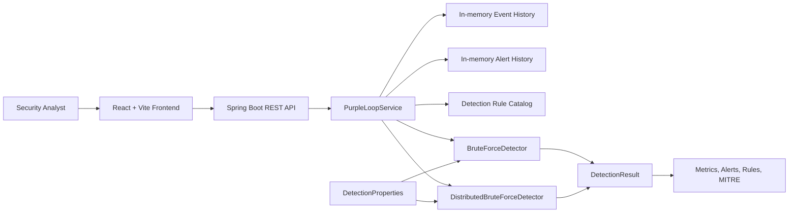

# PurpleLoop

PurpleLoop is a purple-team simulation and detection-engineering dashboard built with Spring Boot and React. It models controlled single-source and distributed brute-force workflows, stores synthetic authentication telemetry in memory, evaluates time-windowed detection rules, and visualizes metrics, alert history, and MITRE ATT&CK mappings.

## Architecture



## Project Overview

This project demonstrates:
- Java + Spring Boot REST API design
- Authentication telemetry generation and retention
- Stateful, time-windowed detection across processing batches
- Single-source and distributed brute-force detection
- Detection rule metadata and MITRE ATT&CK mapping for T1110 (Brute Force)
- Event, alert-category, login-outcome, and MTTD metrics
- React-driven dashboard integration
- Unit testing and production build validation

## Features

- Synthetic failed-login event generation with realistic timestamps
- In-memory event history retained while the backend process remains running
- Single-source detection at 3 failed attempts per IP within a 5-minute window by default
- Distributed detection at 6 failures from at least 3 IPs against the same account within that window
- Episode-based alert deduplication, with a new alert after the prior episode expires
- Stable event IDs and per-detector replay suppression within the active detection window
- Configurable rolling simulation rate limit and bounded event/alert history with oldest-first eviction
- Synthetic distributed attack simulation from multiple IPs against a shared target account
- Rule identifiers, descriptions, severity, status, and ATT&CK mapping available through the API
- Dashboard for overview metrics, events, detections, and MITRE technique mapping
- Simulation triggered only by the user clicking the dashboard button
- Local development and Render/Vercel deployment preparation

## Detection Logic

`BruteForceDetector` retains timestamped failed login attempts by source IP, prunes attempts outside the configured window, and emits one alert when a source reaches its threshold. Further failures do not produce duplicate alerts for that episode; after the episode expires, a new threshold crossing can alert again. Valid event timestamps are ordered so delayed events still count when they remain inside the window. Successful logins never increment failure totals.

`DistributedBruteForceDetector` applies a separate threshold per target account and requires both a minimum failure count and a minimum number of distinct source IPs. Its current behavior maps to **T1110 — Brute Force**. It does not claim **T1110.003 — Password Spraying**: events do not include password evidence, and distributed attempts against one account alone do not establish password spraying.

Alerts preserve the original `ruleName`, `sourceIp`, `failedAttempts`, `severity`, and `mitreTechnique` fields and add a unique ID, rule ID, source IP list, target account, detection/episode timestamps, and a descriptive message. MTTD is the average alert timestamp minus episode-start timestamp for alerts with valid nonnegative timestamps; it is zero when no measurable alerts exist.

Simulation endpoints share an in-memory rolling rate limit (default 20 requests per minute). Event and alert histories are also bounded in memory (defaults: 10,000 events and 5,000 alerts); oldest records are evicted first and metrics describe retained history. Event IDs are deduplicated by each detector only while they remain within its active time window. Rate-limit counters, history, and idempotency state are process-local: restarts reset them, and separate replicas do not coordinate them. These controls are not substitutes for shared rate limiting, authentication, durable storage, or pagination in a multi-instance deployment.

## API Endpoints

- `GET /api/health` — backend health status
- `GET /api/events` — current in-memory event history
- `GET /api/alerts` — current in-memory alert history
- `GET /api/metrics` — event/alert totals, unique IPs, failed and successful login counts, alert categories, and mean time to detect in milliseconds
- `GET /api/rules` — detection rule metadata and enabled/disabled status
- `POST /api/simulate/brute-force` — generates new failed-login telemetry, records it, runs detection, and returns newly generated alerts
- `POST /api/simulate/distributed-brute-force` — generates failures from multiple IPs against one synthetic account and returns newly generated alerts
- Simulation requests exceeding the configured rolling limit return HTTP `429 Too Many Requests`.

The original `/api/health`, `/api/events`, `/api/alerts`, `/api/metrics`, and `/api/simulate/brute-force` routes remain available.

## Technologies Used

- Java 25 (LTS)
- Spring Boot 3.5.6
- Maven
- React 19
- Vite 8
- Recharts
- Lucide React

## Prerequisites

- Java 25 (LTS)
- Maven 3.9+
- Node.js 20.19+ or 22.12+ and npm

## Local Setup

1. Clone the repository.
2. In the project root, start the backend:

```bash
mvn spring-boot:run
```

3. In the `frontend` directory, install dependencies:

```bash
cd frontend
npm install
```

4. Create a local frontend environment file from the sample:

```bash
cp .env.example .env
```

5. Start the frontend:

```bash
npm run dev -- --host 0.0.0.0
```

6. The local app should run with the backend on port 8080 and the frontend on port 5173 by default.

## Configuration

Environment variables:

- Detection configuration (can also be set in `application.properties`):
  - `PURPLELOOP_DETECTION_BRUTE_FORCE_FAILURE_THRESHOLD` (default `3`, must be at least `1`)
  - `PURPLELOOP_DETECTION_WINDOW` (default `PT5M`, a positive ISO-8601 duration)
  - `PURPLELOOP_DETECTION_DISTRIBUTED_FAILURE_THRESHOLD` (default `6`, must be at least `1`)
  - `PURPLELOOP_DETECTION_MINIMUM_DISTINCT_SOURCE_IPS` (default `3`, must be at least `2`)
  - `PURPLELOOP_DETECTION_BRUTE_FORCE_ENABLED` (default `true`)
  - `PURPLELOOP_DETECTION_DISTRIBUTED_ENABLED` (default `true`)
  - `PURPLELOOP_DETECTION_SIMULATION_RATE_LIMIT` (default `20`, between `1` and `10000` requests)
  - `PURPLELOOP_DETECTION_SIMULATION_RATE_WINDOW` (default `PT1M`, a positive ISO-8601 duration)
  - `PURPLELOOP_DETECTION_MAX_EVENT_HISTORY_SIZE` (default `10000`, between `1` and `1000000`)
  - `PURPLELOOP_DETECTION_MAX_ALERT_HISTORY_SIZE` (default `5000`, between `1` and `1000000`)
- Frontend (Vite): `VITE_API_BASE_URL`
  - Required on Vercel; set it to the backend base URL, such as `https://your-service.onrender.com`.
  - Optional locally; if unset, Vite's `/api` proxy forwards requests to `http://localhost:8080`.
- Backend: `CORS_ALLOWED_ORIGINS`
  - Set to the exact Vercel origin in Render. For local development, the default allows `http://localhost:5173` and `http://127.0.0.1:5173`.

Do not use a wildcard production CORS origin.

## Testing and Build

Run backend tests:

```bash
mvn clean test
mvn clean package
```

Run the frontend production build:

```bash
npm --prefix frontend run build
npm --prefix frontend run lint
```

## Deployment

### Backend on Render

A Render Blueprint is provided in `render.yaml`. It deploys the Spring Boot backend as a Docker web service because Render's native runtimes do not include Java. The root `Dockerfile` builds the application with Maven and Java 25, then runs the generated Spring Boot JAR with a Java 25 runtime.

Deployment settings:
- Root Directory: repository root (`.`)
- Runtime: Docker
- Dockerfile Path: `./Dockerfile`
- Docker Build Context: `.`
- Health Check Path: `/api/health`
- Do not set a custom build or start command; the Dockerfile builds and starts the app.

The Maven package command used by the Dockerfile is `mvn -B package` from the repository root. It produces `target/purpleloop-0.1.0-SNAPSHOT.jar`. The app binds to Render's assigned `PORT`; `src/main/resources/application.properties` defaults to port `8080` for local development. Render supplies its own `PORT`, so do not hardcode a deployed port.

After the Vercel deployment is created and its production domain is known, set this Render environment variable:

```text
CORS_ALLOWED_ORIGINS=https://your-project.vercel.app
```

Use only the exact origin (scheme + hostname, no path or trailing slash). If additional known Vercel domains must call the API, provide a comma-separated list of exact origins. Do not include localhost in the production value unless local browser clients specifically need access. When unset locally, the backend permits `http://localhost:5173` and `http://127.0.0.1:5173`.

Render's free service may sleep while idle or restart, and in-memory events/alerts are lost on restart. The exact free-tier behavior can vary; check Render's current plan details before deploying.

### Frontend on Vercel

Create a Vercel project connected to this repository with:
- Root Directory: `frontend`
- Framework Preset: Vite (or Other)
- Build Command: `npm run build`
- Output Directory: `dist`
- Environment variable for Production: `VITE_API_BASE_URL=https://your-service.onrender.com`

The frontend reads `VITE_API_BASE_URL` at build time, strips trailing slashes, and uses it for all API requests. For local development, `frontend/.env.example` shows the local backend URL; the Vite dev-server proxy also forwards `/api` requests to `http://localhost:8080` when the variable is unset. `frontend/vercel.json` rewrites direct paths to `index.html` so the Vite single-page app can be refreshed or opened at a direct URL.

### Deployment order

1. Deploy the backend to Render using the repository Blueprint/Dockerfile. Confirm the Render `/api/health` URL returns a successful response.
2. Deploy the frontend to Vercel with Root Directory `frontend` and `VITE_API_BASE_URL` set to the Render service's HTTPS base URL.
3. Copy the Vercel production origin (for example, `https://your-project.vercel.app`) into Render's `CORS_ALLOWED_ORIGINS` environment variable and redeploy the backend.
4. Open the Vercel site, refresh it, confirm API data loads, and trigger a simulation manually. If Vercel preview deployments should also call the backend, add their exact origins as a comma-separated list in Render.

Deployment instructions describe configuration only; no live deployment is claimed.

## Known Limitations

- Event and alert history are retained in backend memory only while the Spring Boot process remains running.
- A backend restart resets the in-memory state.
- Detection attempt state, events, and alerts are in-memory and local to one application process; the detectors are not distributed across backend replicas.
- Simulation rate limiting is process-local and can be bypassed across multiple backend replicas; it is not a replacement for an edge/API gateway limit.
- Event replay suppression is also in-memory and covers IDs retained in the active detection window; it is not durable, cross-replica idempotency.
- History limits bound memory use by evicting oldest events and alerts, so metrics and API history cover retained records only.
- Synthetic authentication events contain no passwords or password hashes, so password spraying cannot be inferred or mapped to T1110.003.
- Distributed simulation generates enough distinct synthetic IPv4 addresses for the configured IP threshold, up to 65,536; it is controlled demonstration data, not production attack telemetry.
- This is a controlled simulation platform and not a production SIEM or detection system.
- Free hosting platforms may sleep or restart the service without notice.

## Future Improvements

- Persistent storage with PostgreSQL or SQLite
- More detection rules and validated ATT&CK mappings
- Realistic alert lifecycle states such as open, acknowledged, resolved
- Authentication and authorization for the portal
- CI/CD pipeline and release automation

## Security Notes

- No secrets, tokens, or credentials are required to run the project locally.
- Environment-specific values should be stored in deployment environment variables, not hardcoded into source files.
- CORS is limited to explicit allowed origins rather than allowing every origin.

## Git Status

Before deployment or final review, run:

```bash
git status --short
```

Do not commit or push without explicit authorization.
