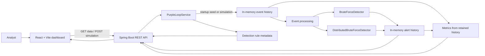

# PurpleLoop

PurpleLoop is a small purple-team and detection-engineering demonstration platform. A Spring Boot API generates controlled authentication events, evaluates two brute-force detection rules, and exposes retained events, alerts, and metrics to a React dashboard.

All current telemetry is synthetic. PurpleLoop does not collect endpoint or identity-provider logs, authenticate users, block attackers, or provide a production SIEM.

## Problem and objectives

Security teams need a repeatable way to exercise detection logic and see what evidence a rule produces. PurpleLoop demonstrates that workflow with a narrow, inspectable set of simulated authentication events.

The project aims to:

- Generate repeatable single-source and distributed brute-force scenarios.
- Evaluate event timestamps against configurable rolling windows.
- Return explainable alerts with source, target, severity, and ATT&CK metadata.
- Display API-backed event activity, alert history, and retained-history metrics.
- Keep the implementation small enough to run locally without a database or external services.

## Features

- Synthetic failed and successful login events, including a small seed dataset when the backend starts.
- Single-source brute-force detection grouped by source IP.
- Distributed brute-force detection grouped by target account and distinct source IP.
- Timestamp-window expiry, duplicate event-ID suppression inside the active window, and one alert per active detection episode.
- Configurable thresholds, detection window, simulation request limit, and bounded event/alert history.
- REST endpoints for health, events, alerts, metrics, detection rules, and manually triggered simulations.
- A React dashboard that reads API data, shows loading/error/empty states, and starts simulations only after a user action.

## Architecture



The runtime flow is **Simulation → Events → Processing → Detection → Alerts → Metrics → Dashboard**. The simulation endpoints create events in the backend; the frontend then reloads events, alerts, and metrics from the API. The browser does not run detection logic.

## Detection engine

| Rule ID | Rule | Current behavior | Default threshold | Severity | MITRE ATT&CK |
|---|---|---|---|---|---|
| `PL-BF-001` | Repeated Failed Logins | Counts failed logins from the same source IP within the detection window. Attempts are grouped by IP, not by account. | 3 failures in 5 minutes | HIGH | [T1110 — Brute Force](https://attack.mitre.org/techniques/T1110/) |
| `PL-DBF-001` | Distributed Brute Force | Counts failed logins against the same valid target account and requires both enough failures and enough distinct source IPs. | 6 failures from at least 3 IPs in 5 minutes | HIGH | [T1110 — Brute Force](https://attack.mitre.org/techniques/T1110/) |

Both rules ignore successful logins, emit one alert while a qualifying episode remains active, and can emit again after the rolling state drops below its threshold and a new episode qualifies. The window includes an event exactly at its cutoff. Events more than five minutes in the future (or farther than the configured detection window when that window is shorter) are ignored. Delayed events inside the active window can still count.

The distributed rule requires a nonblank target account other than `unknown`; it will not combine attempts against different accounts. The project does not inspect passwords or password hashes, so it does not claim to detect or map [T1110.003 — Password Spraying](https://attack.mitre.org/techniques/T1110/003/).

Severity is currently a fixed rule attribute, not a calculated risk score. Event IDs are generated for simulated events; detector-level duplicate suppression applies only while IDs remain in the active detection window.

## Simulation methodology

On backend startup, the service adds six synthetic events: five failed logins from one IP and one successful login. With the default rule settings, this produces an initial single-source alert. This seed data is provided for dashboard demonstration and is not observed activity.

The two `POST` simulation endpoints generate new failed-login events:

- The single-source scenario uses one synthetic source IP and the configured single-source threshold.
- The distributed scenario targets one synthetic account and generates enough distinct synthetic source IPs to meet the configured failure and IP thresholds.

The dashboard does not trigger a simulation on initial page load or refresh. Simulations are triggered by the dashboard buttons or by an explicit API `POST`.

## Metrics

The metrics endpoint describes the **currently retained in-memory history**, not a durable or complete event archive.

| Metric | Calculation |
|---|---|
| `totalEvents` | Number of retained events. |
| `totalAlerts` | Number of retained alerts. |
| `uniqueSourceIps` | Distinct, nonblank source IPs in retained events. |
| `totalFailedLogins` / `totalSuccessfulLogins` | Counts of retained events by `success` value. |
| `bruteForceAlerts` / `distributedAttackAlerts` | Retained alerts grouped by rule ID. |
| `meanTimeToDetectMs` | Rounded average of `detectedAt - attackStartedAt` across retained alerts with both timestamps and a nonnegative duration; `0` when none qualify. |

The activity chart groups valid retained event timestamps into 24 hour-of-day buckets, interpreted in the browser's local time zone. It is not a request-rate or time-series chart.

## Screenshots

Screenshots are not included yet. Add genuine captures after running the application; do not treat these entries as screenshots.

- Dashboard overview — _screenshot not captured_
- Single-source simulation result — _screenshot not captured_
- Distributed simulation result — _screenshot not captured_

## Technology stack

- Java 25 and Spring Boot 3.5.6
- Maven
- React 19 and Vite 8
- Recharts and Lucide React
- JUnit 5 and Spring Boot Test for backend tests
- Vitest, jsdom, and Testing Library for frontend tests

## Prerequisites

- JDK 25
- Maven 3.9 or newer
- Node.js 22.22.2+, 24.15+, or 26+ and npm (required by the frontend test environment)

## Run locally

Start the backend from the repository root:

```bash
mvn spring-boot:run
```

In a second terminal, install the locked frontend dependencies and start Vite:

```bash
cd frontend
npm ci
npm run dev
```

Open `http://localhost:5173`. When `VITE_API_BASE_URL` is unset, the Vite development server proxies `/api` requests to `http://localhost:8080`. The backend defaults to port `8080`, or uses the `PORT` environment variable when provided.

To run simulations locally, configure `PURPLELOOP_SIMULATION_ACCESS_TOKEN` in the backend process with a randomly generated value of at least 32 UTF-8 bytes, then enter that same value in the dashboard's simulation access field. Keep it out of source control and frontend `VITE_` variables. Without it, dashboard reads remain available and simulation requests fail closed.

To run tests and build artifacts:

```bash
mvn clean test
mvn clean package
npm --prefix frontend run test
npm --prefix frontend run lint
npm --prefix frontend run build
```

## Configuration

Backend detection settings are bound from `purpleloop.detection` properties. The environment variable names and defaults are:

| Environment variable | Default | Accepted values |
|---|---:|---|
| `PURPLELOOP_DETECTION_BRUTE_FORCE_FAILURE_THRESHOLD` | `3` | 1–100,000 |
| `PURPLELOOP_DETECTION_WINDOW` | `PT5M` | Positive ISO-8601 duration |
| `PURPLELOOP_DETECTION_DISTRIBUTED_FAILURE_THRESHOLD` | `6` | 1–100,000 |
| `PURPLELOOP_DETECTION_MINIMUM_DISTINCT_SOURCE_IPS` | `3` | 2–65,536 |
| `PURPLELOOP_DETECTION_BRUTE_FORCE_ENABLED` | `true` | `true` or `false` |
| `PURPLELOOP_DETECTION_DISTRIBUTED_ENABLED` | `true` | `true` or `false` |
| `PURPLELOOP_DETECTION_SIMULATION_RATE_LIMIT` | `20` | 1–10,000 requests |
| `PURPLELOOP_DETECTION_SIMULATION_RATE_WINDOW` | `PT1M` | Positive ISO-8601 duration |
| `PURPLELOOP_DETECTION_MAX_EVENT_HISTORY_SIZE` | `10000` | 1–1,000,000 events |
| `PURPLELOOP_DETECTION_MAX_ALERT_HISTORY_SIZE` | `5000` | 1–1,000,000 alerts |
| `PURPLELOOP_SIMULATION_ACCESS_TOKEN` | Unset (simulation access disabled) | At least 32 UTF-8 bytes |

`CORS_ALLOWED_ORIGINS` is a comma-separated list of exact browser origins. If unset, the backend allows `http://localhost:5173` and `http://127.0.0.1:5173`. Configure the production frontend origin explicitly; do not use a wildcard.

`VITE_API_BASE_URL` sets the backend base URL in the frontend at build time. It is optional for local development and should be the deployed backend's HTTPS origin for a Vercel build. The example file is `frontend/.env.example`.

Simulation `POST` requests require a bearer token that the backend checks against `PURPLELOOP_SIMULATION_ACCESS_TOKEN`. Configure a randomly generated value of at least 32 UTF-8 bytes in the backend runtime environment. If the setting is absent or too short, simulation requests fail closed with `503`; a missing or incorrect request token returns `401`. The dashboard accepts the operator token in a password field and keeps it only in page memory; it is not stored in local storage or embedded in the frontend build. Do not create a `VITE_` variable for this token. Read-only API requests remain public. CORS is a browser policy, not authorization.

## API reference

All endpoints are under `/api`. The current API has no query parameters and no event-ingestion endpoint. The simulation `POST` endpoints accept no request body. Responses are JSON; timestamps are serialized from Java `LocalDateTime` values without an explicit time-zone offset.

| Method and path | Request | Success response |
|---|---|---|
| `GET /api/health` | None | Object with `project`, `status`, and `message`. This is a process-level health response. |
| `GET /api/events` | None | Array of retained event objects: `id`, `ip`, `success`, `username`, `timestamp`. |
| `GET /api/alerts` | None | Array of retained alert objects: `id`, `ruleId`, `ruleName`, `sourceIp`, `sourceIps`, `username`, `failedAttempts`, `severity`, `mitreTechnique`, `detectedAt`, `attackStartedAt`, `message`. |
| `GET /api/metrics` | None | Object containing the metric fields described above. |
| `GET /api/rules` | None | Array of rule objects with `ruleId`, `ruleName`, `description`, `severity`, `mitreTechnique`, `detectionStatus`, and `enabled`. |
| `POST /api/simulate/brute-force` | `Authorization: Bearer <operator token>`; no body or query parameters | Array of newly generated detection alerts; generated events are also added to retained history. |
| `POST /api/simulate/distributed-brute-force` | `Authorization: Bearer <operator token>`; no body or query parameters | Array of newly generated detection alerts; generated events are also added to retained history. |

Successful requests return `200 OK`. Simulation requests without a valid bearer token return `401 Unauthorized`; if the backend token is not configured or is too short, they return `503 Service Unavailable`. Simulation requests over the configured in-process rolling limit return `429 Too Many Requests`. These expected errors and unsupported methods return a Spring `ProblemDetail` body. Other framework or server errors are not promised to use this same error schema.

Read-only routes are public. Simulation routes use a single shared operator token, not per-user authentication or authorization. Anyone who obtains that token can run simulations; distribute it only through a secure channel and rotate it if exposed. The API remains intended for controlled demonstration use, not as a trusted production data service.

## Deployment architecture

The repository includes deployment configuration for a split deployment:

- **Backend:** `render.yaml` declares a Docker web service with `/api/health` as its health-check path. The root `Dockerfile` packages the Spring Boot application and runs its JAR as a non-root user.
- **Frontend:** deploy the `frontend` directory to Vercel as a Vite app. `frontend/vercel.json` supplies SPA rewrites and browser security headers.
- **Connection:** set Vercel's `VITE_API_BASE_URL` to the backend HTTPS origin. Set Render's `CORS_ALLOWED_ORIGINS` to the exact Vercel origin and configure `PURPLELOOP_SIMULATION_ACCESS_TOKEN` as a backend secret. The token is entered by an authorized operator in the dashboard; it is not a Vercel build variable.

For Vercel, use the `frontend` directory as the project root, `npm run build` as the build command, and `dist` as the output directory. Set `VITE_API_BASE_URL` in the Vercel environment before building. Configure `CORS_ALLOWED_ORIGINS` in the backend environment after the frontend domain is known. Actual cloud deployment and provider-side environment settings are not included in this repository.

## Known limitations

- Events, alerts, detector state, duplicate-ID tracking, and simulation rate-limit counters are in memory. Restarting the process loses them; separate replicas do not share them.
- Event and alert histories are bounded by configuration and evict the oldest entries. Metrics and API history therefore cover retained records only.
- The simulation rate limit is global to one process, not per user or shared across replicas. It is not a substitute for edge/API-gateway rate limiting.
- The simulation bearer token is a shared operator credential, not user-level authentication; read-only routes remain public. The token must be configured separately in each backend replica.
- There is no external event ingestion, persistent storage, alert lifecycle, or response automation.
- The brute-force detector groups by source IP regardless of account. The distributed detector groups by account but only supports the described failed-login behavior.
- Simulated events are controlled test data, not evidence of real attacks or validation against a real identity provider.
- This project demonstrates a limited detection workflow; it is not a production SIEM or a complete purple-team platform.

## Possible next steps

- Add authenticated, validated event ingestion and access control if the project expands beyond a local demonstration.
- Add durable storage and cross-instance coordination for history, deduplication, and rate limits.
- Add detection rules only with explicit event requirements and validated ATT&CK mappings.
- Add alert lifecycle and operational integrations.
- Add CI workflows for backend tests, frontend tests, and release builds.

## Project information

- Repository: [AnupamGupta-Pro00Nation/purpleloop](https://github.com/AnupamGupta-Pro00Nation/purpleloop)
- Project name and Maven artifact: `PurpleLoop` / `com.purpleloop:purpleloop`
- The repository does not specify a separate author contact in this README.
