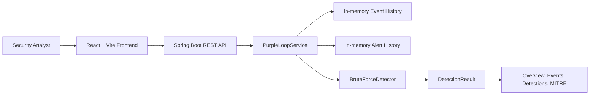

# PurpleLoop

PurpleLoop is a purple-team simulation and detection-engineering dashboard built with Spring Boot and React. It models a controlled brute-force attack workflow, stores synthetic authentication telemetry in memory, evaluates a threshold-based detection rule, and visualizes current metrics, alert history, and MITRE ATT&CK mapping.

## Architecture



## Project Overview

This project demonstrates:
- Java + Spring Boot REST API design
- Authentication telemetry generation and retention
- Threshold-based behavioral detection
- MITRE ATT&CK mapping for T1110 (Brute Force)
- React-driven dashboard integration
- Unit testing and production build validation

## Features

- Synthetic failed-login event generation with realistic timestamps
- In-memory event history retained while the backend process remains running
- Brute-force detection at a threshold of 3 failed attempts per source IP
- Alert storage, deduplication, and metrics calculation
- Dashboard for overview metrics, events, detections, and MITRE technique mapping
- Simulation triggered only by the user clicking the dashboard button
- Local development and Render/Vercel deployment preparation

## Detection Logic

The core detector groups failed authentication events by source IP and increments a counter for each failed attempt. When the threshold reaches 3 failed logins for a given IP, the detector emits a `DetectionResult` with:

- ruleName: `Repeated Failed Logins`
- sourceIp: offending source address
- failedAttempts: actual failed-attempt count at the threshold
- severity: `HIGH`
- mitreTechnique: `T1110`

Successful logins do not count toward the failed-attempt total. Alert deduplication prevents identical repeated detections from being added multiple times for the same condition in the retained in-memory alert list.

## API Endpoints

- `GET /api/health` — backend health status
- `GET /api/events` — current in-memory event history
- `GET /api/alerts` — current in-memory alert history
- `GET /api/metrics` — total events, total alerts, and unique source IPs
- `POST /api/simulate/brute-force` — generates new failed-login telemetry, records it, runs detection, and returns newly generated alerts

## Technologies Used

- Java 21
- Spring Boot 3.5.6
- Maven
- React 19
- Vite 8
- Recharts
- Lucide React

## Prerequisites

- Java 21 or newer
- Maven 3.9+
- Node.js 20.19+ or 22.12+ and npm

## Local Setup

1. Clone the repository.
2. In the project root, start the backend:

```bash
mvn spring-boot:run
```

3. In the `frontend` directory, install dependencies:

```bash
cd frontend
npm install
```

4. Create a local frontend environment file from the sample:

```bash
cp .env.example .env
```

5. Start the frontend:

```bash
npm run dev -- --host 0.0.0.0
```

6. The local app should run with the backend on port 8080 and the frontend on port 5173 by default.

## Configuration

Environment variables:

- Frontend (Vite): `VITE_API_BASE_URL`
  - Required on Vercel; set it to the backend base URL, such as `https://your-service.onrender.com`.
  - Optional locally; if unset, Vite's `/api` proxy forwards requests to `http://localhost:8080`.
- Backend: `CORS_ALLOWED_ORIGINS`
  - Set to the exact Vercel origin in Render. For local development, the default allows `http://localhost:5173` and `http://127.0.0.1:5173`.

Do not use a wildcard production CORS origin.

## Testing and Build

Run backend tests:

```bash
mvn clean test
```

Run the frontend production build:

```bash
cd frontend
npm run build
```

## Deployment

### Backend on Render

A Render Blueprint is provided in `render.yaml`. It deploys the Spring Boot backend as a Docker web service because Render's native runtimes do not include Java. The root `Dockerfile` builds the application with Maven and Java 21, then runs the generated Spring Boot JAR with a Java 21 runtime.

Deployment settings:
- Root Directory: repository root (`.`)
- Runtime: Docker
- Dockerfile Path: `./Dockerfile`
- Docker Build Context: `.`
- Health Check Path: `/api/health`
- Do not set a custom build or start command; the Dockerfile builds and starts the app.

The Maven package command used by the Dockerfile is `mvn -B package` from the repository root. It produces `target/purpleloop-0.1.0-SNAPSHOT.jar`. The app binds to Render's assigned `PORT`; `src/main/resources/application.properties` defaults to port `8080` for local development. Render supplies its own `PORT`, so do not hardcode a deployed port.

After the Vercel deployment is created and its production domain is known, set this Render environment variable:

```text
CORS_ALLOWED_ORIGINS=https://your-project.vercel.app
```

Use only the exact origin (scheme + hostname, no path or trailing slash). If additional known Vercel domains must call the API, provide a comma-separated list of exact origins. Do not include localhost in the production value unless local browser clients specifically need access. When unset locally, the backend permits `http://localhost:5173` and `http://127.0.0.1:5173`.

Render's free service may sleep while idle or restart, and in-memory events/alerts are lost on restart. The exact free-tier behavior can vary; check Render's current plan details before deploying.

### Frontend on Vercel

Create a Vercel project connected to this repository with:
- Root Directory: `frontend`
- Framework Preset: Vite (or Other)
- Build Command: `npm run build`
- Output Directory: `dist`
- Environment variable for Production: `VITE_API_BASE_URL=https://your-service.onrender.com`

The frontend reads `VITE_API_BASE_URL` at build time, strips trailing slashes, and uses it for all API requests. For local development, `frontend/.env.example` shows the local backend URL; the Vite dev-server proxy also forwards `/api` requests to `http://localhost:8080` when the variable is unset. `frontend/vercel.json` rewrites direct paths to `index.html` so the Vite single-page app can be refreshed or opened at a direct URL.

### Deployment order

1. Deploy the backend to Render using the repository Blueprint/Dockerfile. Confirm the Render `/api/health` URL returns a successful response.
2. Deploy the frontend to Vercel with Root Directory `frontend` and `VITE_API_BASE_URL` set to the Render service's HTTPS base URL.
3. Copy the Vercel production origin (for example, `https://your-project.vercel.app`) into Render's `CORS_ALLOWED_ORIGINS` environment variable and redeploy the backend.
4. Open the Vercel site, refresh it, confirm API data loads, and trigger a simulation manually. If Vercel preview deployments should also call the backend, add their exact origins as a comma-separated list in Render.

Deployment instructions describe configuration only; no live deployment is claimed.

## Known Limitations

- Event and alert history are retained in backend memory only while the Spring Boot process remains running.
- A backend restart resets the in-memory state.
- This is a controlled simulation platform and not a production SIEM or detection system.
- Free hosting platforms may sleep or restart the service without notice.

## Future Improvements

- Persistent storage with PostgreSQL or SQLite
- More detection rules beyond brute-force detection
- Realistic alert lifecycle states such as open, acknowledged, resolved
- Authentication and authorization for the portal
- CI/CD pipeline and release automation

## Security Notes

- No secrets, tokens, or credentials are required to run the project locally.
- Environment-specific values should be stored in deployment environment variables, not hardcoded into source files.
- CORS is limited to explicit allowed origins rather than allowing every origin.

## Git Status

Before deployment or final review, run:

```bash
git status --short
```

Do not commit or push without explicit authorization.
